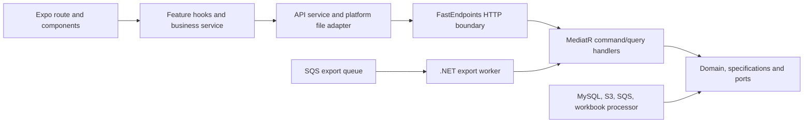
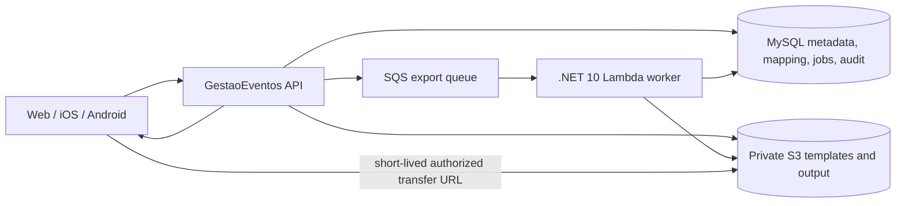

# Architecture Spine — Exportação Excel configurável por Estrutura

## Design Paradigm

**Feature-sliced layered client + Clean Architecture/CQRS API.** The React client owns presentation, business orchestration, API calls and platform file adapters. FastEndpoints only binds HTTP contracts; MediatR handlers in UseCases authorize and coordinate domain/repository operations; Infrastructure implements MySQL, private S3, queue and workbook processor ports. An isolated worker consumes export jobs and uses the same UseCases/domain rules.

## Inherited Invariants

The feature inherits the parent spine read-only; its existing AD IDs remain unchanged.

| Inherited | From parent | Binds here |
| --- | --- | --- |
| AD-1 — Expo universal app | `architecture-GestaoEventos-react-app-2026-08-29/ARCHITECTURE-SPINE.md` | Full feature capability on web, iOS and Android; platform differences behind adapters and responsive components. |
| AD-2 — Angular parity baseline | Same | New API contracts remain compatible with Angular during coexistence; React does not displace the production baseline early. |
| AD-3 — Feature-sliced layered boundaries | Same | Screens call business hooks/services; API services own HTTP; React Query owns remote state. |
| AD-4 — Existing backend contract, no BFF | Same | React calls GestaoEventos.API directly under `/api`; use canonical case/envelope/error handling. |
| AD-5 — Active context and server authorization | Same | Every operation binds to the active Estrutura and is authorized by the server; owner bypass does not cross Estruturas. |
| AD-6 — One route tree, responsive shells | Same | One Expo Router route tree with mobile and web adaptations. |
| AD-7 — Product design system and agnostic language | Same | Use Grupo/Estrutura/person terminology, established tokens, accessible controls and mobile cards/sheets. |
| AD-8 — Feature implementation follows real contracts | Same | Integrate with the existing frequency report and real endpoint behavior; preserve existing CSV. |
| AD-9 — Four-point analytics contract | Same | Track visualization, entrance, simulation and confirmation through approved services; never send workbook data or personal values. |
| AD-10 — Offline read-only | Same | Upload, publish, preview and export mutations are unavailable offline and are not queued. |
| AD-11 — Platform adapters | Same | File selection, upload, download and share use one feature-facing contract with web/native implementations. |
| AD-12 — Explicit environment configuration | Same | `EXPO_PUBLIC_API_URL` remains required in preview/production; S3 transfer URLs are short-lived API-issued capabilities, never client environment configuration. |
| AD-13 — Release parity gate | Same | Feature release follows existing build, type, lint, parity and relevant smoke requirements. |
| AD-14 — Canonical client contracts | Same | API response, error, context and permission shapes remain canonical. |
| AD-15 — Scoped query key and cache clearing | Same | Template, preview and job status keys include active Estrutura; clear scoped state on context switch. |
| AD-16 — Permission facade | Same | Client visibility uses `can(action, resource, scope)`; backend remains authoritative. |
| AD-17 — Parity manifest | Same | Add required `GestaoEventos.React/docs/parity-manifest.md` rows for configuration and export routes, endpoints, permission codes, analytics, tests, status and gaps. |
| AD-18 — Operational envelope | Same | Keep dev/preview/prod, rollback and telemetry; configure both API CORS and exact S3 bucket CORS for web file transfer in preview and production. |

## Invariants & Rules

### AD-19 — Server-Owned Workbook Processing

- **Binds:** FR-2–FR-5 and FR-9; workbook inspection, mapping validation, preview and generation.
- **Prevents:** browser/native differences in formula, macro, parsing and validation behavior.
- **Rule:** All workbook inspection and mutation run behind a server-side `IWorkbookProcessor` port in Infrastructure. No client library generates the authoritative workbook. Select a concrete processor only after round-trip validation against sanitized representative `.xlsx` and `.xlsm` fixtures. It must preserve required formulas and embedded VBA, must not execute macros or external connections, and must reject features it cannot safely preserve.

### AD-20 — Structure-Scoped Immutable Model Versions

- **Binds:** FR-1, FR-3, FR-6 and FR-10; model metadata, mapping documents, files and audit records.
- **Prevents:** one Estrutura reading another's templates, published exports changing after publication, or user-configured code querying arbitrary data.
- **Rule:** Store model/version metadata, constrained mapping JSON and job/audit metadata in MySQL; store workbook binaries in a private S3 bucket under server-generated keys scoped by Estrutura and immutable version. Each model has at most one active published version; distinct models may be active concurrently. Publication atomically switches the model's active-version pointer; prior versions remain immutable history. Export-preview tokens bind an exact model/version, and export confirmation rechecks that it is still active/published; replacement or deactivation since export preview invalidates the token and requires a new export preview. Once confirmed, the job pins that version and may finish even if it is later superseded. Edits create a new draft/version. Mapping JSON references only catalog field IDs, sheet/cell or repeated-region coordinates and presentation options; it contains no SQL, script or executable formula. Schema changes use idempotent SQL, not generated EF migrations.

### AD-21 — Asynchronous Workbook Workflows

- **Binds:** FR-2, FR-5, FR-8–FR-10; template validation, preview snapshot preparation, generation and delivery.
- **Prevents:** request timeout, duplicate output from retries, and a UI claiming success while the worker failed.
- **Rule:** The API handles authorization and metadata only; typed SQS work items in dedicated .NET 10 Lambda workers use four distinct kinds: `template-validation`, `model-preview`, `export-preview`, and `export-generation`. `model-preview` validates a draft mapping against a bounded authorized sample and creates no export snapshot; `export-preview` requires the active published version, executes the export projection and creates the exact-data snapshot consumed by generation. In one MySQL transaction, each work item and outbox event are persisted; a separate .NET 10 Lambda outbox dispatcher, invoked by EventBridge on a schedule independent of HTTP traffic, claims unsent rows, sends the work-item ID/type to SQS, then marks the event delivered. An ack loss may redeliver, so dispatch and consumption are idempotent. A worker conditionally claims a work item with a lease token, rechecks its state before each terminal update, and writes output to a lease-specific S3 key. Only the worker that wins a conditional terminal transition binds accepted immutable objects; losing/retried attempts are orphaned for lifecycle cleanup. Persist separate bounded lifecycles for upload validation, model preview, export preview readiness and export generation; a DLQ and reconciler requeue expired leases up to the retry limit then mark a stable sanitized failure code. Client idempotency keys are unique per actor/Estrutura/idempotency key; repeating the key with a different canonical request fingerprint returns conflict, while the same request returns the existing work item. Export-generation work refers to an export-preview snapshot ID, never its row data. The authorized client polls status; it enables mapping after template validation, enables publication only after model preview, shows report review only after export preview, and offers a file only after export generation completes.

### AD-22 — Authorization Rechecked at Data Read and Delivery

- **Binds:** FR-1, FR-3, FR-5, FR-7, FR-8 and FR-10; configuration, preview, export, job status and file access.
- **Prevents:** stale client permissions or a guessed job/file ID exposing another Estrutura or Grupo.
- **Rule:** Every user request carries active `estruturaId`; FastEndpoints delegates authorization to UseCases/domain policy. The enqueue path validates the requester, model, fields and Grupo scope; the worker rechecks the requester's current field and Grupo authorization before reading report data. For export-preview/generation, any loss of authorization or scope mismatch between preview and data consumption fails the whole job with a stable authorization-changed reason; partial exports are never delivered. Every job-status and download-URL request verifies requester ownership, active Estrutura, job state and current access to the Groups/fields represented in the artifact; if scope no longer matches, deny a new download URL and mark the artifact unavailable. The API alone issues download URLs with a configured TTL no longer than five minutes; S3 URLs are reusable until expiry, so never claim one-time access. The client cannot supply arbitrary SQL, fields or S3 keys. Owner bypass follows existing domain policy and never bypasses Estrutura isolation.

### AD-23 — Private, Bounded File Exchange

- **Binds:** FR-2 and FR-9; uploads, generated files and web/iOS/Android file flows.
- **Prevents:** public workbook exposure, oversized archive exhaustion, and platform-specific authorization paths.
- **Rule:** The API authorizes file operations and issues time-bounded presigned S3 URLs; buckets block public access, use default SSE-S3 encryption at rest and enable versioning. Uploads first land at a unique, server-generated staging key. A finalize command verifies actor, Estrutura, expected key, byte count and checksum, captures the exact S3 object version ID, then enqueues validation for that exact version (never the mutable latest key). The worker validates OOXML package signature, MIME, archive entry count and expanded size, copies only accepted bytes to an immutable model-version key and marks the draft valid. An unfinalized/invalid staging object cannot be mapped or published; later reuse of its URL creates another staging version and cannot change the accepted immutable copy. Enforce explicit upload/output/processing limits before release. A shared React platform adapter owns native/web selection, transfer, local download and share. Logs strip signed query strings; URLs never appear in analytics or durable audit logs.

### AD-24 — One Versioned Mapping Contract

- **Binds:** FR-3–FR-5 and FR-8; field catalog, mapping editor, preview and worker input.
- **Prevents:** configuration UI, preview and generator interpreting mappings differently.
- **Rule:** A versioned mapping document is the single contract consumed by validation, model preview, export preview and generation. It references only the authorized catalog and contains explicit sheet/cell destinations and repeatable person/Grupo regions. Reject missing required fields, invalid destinations, overlapping writes and any data mapping that targets or overwrites a formula cell before publication. The `model-preview` work item tests the draft mapping against a bounded authorized sample only and cannot issue an export token. One new UseCases export-projection query owns normalized rows, scope, null handling and time boundaries; only `export-preview` runs it for selected filters/model version and stores the exact projected rows as a short-lived private S3 snapshot plus a minimal sample. The API returns that sample/token only after the worker marks export-preview ready; the token is bound to requester, Estrutura, filters and active published model/version. Export-generation requires that token and consumes the same snapshot, so preview rows and generated rows match exactly; snapshot bytes never enter SQS, MySQL audit or logs and are deleted after completion or expiry. Before consuming the snapshot, the worker rechecks current authorization. An expired snapshot requires a new export-preview. Repeatable-region formula propagation and relative-reference adjustment are part of the mapping/processor compatibility contract; previews flag destinations that cannot expand safely. Neither preview calculates formula results.

### AD-25 — Formula, VBA and Audit Privacy Contract

- **Binds:** FR-2, FR-4, FR-8–FR-10; generated XLSX/XLSM, logs, analytics and audit.
- **Prevents:** formulas overwritten by imported data, macro execution, formula-result promises the system cannot keep, and leakage of exported personal data.
- **Rule:** Output extension matches the template. Before publishing an `.xlsm`, tell the user its VBA remains embedded but is never executed; before downloading/sharing the generated file, identify it as macro-enabled. Preserve mapped workbook formulas, styles, hidden support sheets and VBA to the extent proven by the accepted compatibility fixture; set recalculation-on-open and do not calculate formula results. Never run macros, external links or workbook connections. Audit stores actor, Estrutura, model/version, authorized normalized filter IDs, status and timestamps only; never free-text search, workbook rows or file contents. Analytics emits the project's four funnel points with non-sensitive details only.

### AD-26 — Accessible Cross-Platform File and Job Interaction

- **Binds:** UJ-1, UJ-2; mapping editor, file transfer, async job state and permission recovery on web/iOS/Android.
- **Prevents:** an accessible web flow that cannot be completed with keyboard/screen reader on mobile, or silent background failures and stale group selections.
- **Rule:** Spreadsheet destination selection announces the sheet, active cell/range, existing formula, current mapping and repeatable-region state; keyboard and VoiceOver/TalkBack users can confirm or cancel, while mobile keeps the same information in a linear flow. Upload/export states announce start, meaningful phase changes, success and failure; report progress only when measurable, prevent duplicate submit and offer retry for operational failures. An accepted export job has no cancel action in the MVP; leaving the screen does not cancel it. On permission refresh, remove newly unauthorized Groups from selection and require review/reconfirmation before starting again.

### Dependency Direction



## Consistency Conventions

| Concern | Convention |
| --- | --- |
| React feature | `features/relatorios/modelos-exportacao/{screens,components,hooks,types}/` for configuration and `features/relatorios/frequencia/{screens,components,hooks,types}/` for export; routes remain under the existing `(app)` route tree. |
| API service | `services/api/modelos-exportacao.api.ts` and `services/api/relatorios-api.ts`; no HTTP calls in routes/components. |
| API layering | Endpoint → request/response → UseCases command/query/handler → Core policy/port → Infrastructure implementation. Endpoints contain no core business rules. |
| API contracts | Additive FastEndpoints `/api` contracts; snake_case over HTTP and canonical camelCase in React; use existing envelope/error conventions. |
| Mapping identity | Stable field-catalog IDs and a mapping schema version; human labels are display data and never authorization keys. |
| Persistence | MySQL owns model metadata, immutable version metadata, mapping JSON, job state and metadata-only audit. Binary objects remain in private S3. |
| S3 identity | Keys are opaque/server-generated and include a tenant-safe Estrutura scope; staging, immutable template versions and job/attempt outputs use separate prefixes. No client-provided key, public ACL or bucket name in the UI. |
| Job identity | Persist actor ID, Estrutura ID, model version, normalized Group/field filters, snapshot ID and idempotency key; do not duplicate report rows, snapshot bytes or free-text search in the queue payload or audit. Protect filter identifiers under structure isolation and retention policy. Upload validation progresses `pending → validating → valid|rejected`; model preview and export preview progress `queued → processing → ready|failed`; export generation progresses `queued → processing → completed|failed`. |
| Time and output | Store timestamps UTC; render dates using existing report timezone rules; output filename omits personal data and identifies report/date/model version. |
| Analytics | `visualization`, `entrance`, `simulation`, `confirmation` through approved analytics service; no file content, personal values, sensitive field labels, signed URLs or raw object keys. |

## Stack

Versions below are the current brownfield baseline or verified cloud/package facts; dependency additions remain subject to the deferred compatibility decision.

| Name | Version |
| --- | --- |
| Node.js | 22.13.x minimum (repository engine) |
| Expo SDK | 57.0.22 |
| Expo Router | 57.0.21 |
| React | 19.2.3 |
| React Native | 0.86.3 |
| TanStack React Query | 5.102.8 |
| TypeScript | 6.0.3 |
| .NET runtime | API: 8.0 / `dotnet8`; new worker and dispatcher: 10.0 LTS / `dotnet10` |
| FastEndpoints | 5.35.0 |
| MediatR | 12.4.1 |
| Entity Framework Core | 8.0.1 |
| MySQL Server | 8.0.40 |
| AWS Lambda API | Existing API; current SAM default 1024 MiB and 30 seconds |
| AWS S3 / SQS | Managed services; worker and resource configuration are added in SAM |
| AWS SDK clients for S3/SQS and Lambda event handling | Deferred; select a coherent SDK major/version set compatible with the repository's existing AWS SDK v3 packages before implementation |
| DocumentFormat.OpenXml | 3.5.1; open-license compatibility prototype only, not yet approved for production |

## Structural Seed

```text
GestaoEventos.React/
  app/(app)/configuracoes/exportacoes.tsx       # Mais > Configurações da estrutura
  app/(app)/relatorios/frequencia.tsx           # Existing report entry, CSV stays available
  features/relatorios/modelos-exportacao/       # Template/configuration/preview feature slice
    screens/ components/ hooks/ types/
  features/relatorios/frequencia/               # Selection, preview, job status and delivery slice
    screens/ components/ hooks/ types/
  services/platform/files/                      # Shared web/native choose, transfer and share adapter
  docs/parity-manifest.md                       # Required route, endpoint, permission, analytics and release row

GestaoEventos.API/src/
  GestaoEventos.Web/Relatorios/ModelosExportacao/ # HTTP contract only
  GestaoEventos.UseCases/Relatorios/Exportacao/   # Commands, queries, handlers and authorization orchestration
  GestaoEventos.Core/Relatorios/Exportacao/       # Model/version/job rules and ports
  GestaoEventos.Infrastructure/Relatorios/        # MySQL/S3/SQS/workbook processor adapters
  GestaoEventos.ExportWorker/                     # .NET 10 Lambda queue consumer using shared UseCases
  GestaoEventos.ExportOutboxDispatcher/           # Scheduled .NET 10 Lambda; publishes durable MySQL outbox rows to SQS

infra/aws/sam-api.yaml                            # API, private S3, queue/DLQ, worker, IAM and cleanup policy
```



```mermaid
sequenceDiagram
  participant UI as Expo UI
  participant API as FastEndpoints + UseCases
  participant DB as MySQL
  participant S3 as Private S3
  UI->>API: request template upload
  API->>API: validate active context and dynamic permissions
  API->>DB: persist draft and unique staging key
  API-->>UI: short-lived staging upload URL
  UI->>S3: upload template bytes
  UI->>API: finalize upload
  API->>S3: verify size/checksum; capture exact object version ID
  API->>DB: persist validation work item + outbox event
  O->>DB: claim validation outbox row
  O->>Q: send validation work item
  Q->>W: deliver validation item
  W->>S3: validate/copy exact accepted object version
  W->>DB: mark draft valid or rejected
  UI->>API: request model-preview for draft mapping revision
  API->>DB: persist model-preview work item + outbox
  O->>Q: send model-preview item
  Q->>W: deliver model-preview item
  W->>S3: inspect immutable model and evaluate bounded sample mapping
  W->>DB: mark model-preview ready or failed
  UI->>API: poll model-preview status
  API-->>UI: sample and publish eligibility when ready
```

```mermaid
sequenceDiagram
  participant UI as Expo UI
  participant API as FastEndpoints + UseCases
  participant DB as MySQL
  participant O as Scheduled outbox dispatcher
  participant Q as SQS
  participant W as Export Worker
  participant S3 as Private S3
  UI->>API: request export-preview with model version and filters
  API->>API: authorize active Estrutura, fields and Groups
  API->>DB: transactionally persist export-preview work item + outbox
  API-->>UI: export-preview work item ID
  O->>DB: claim pending outbox rows (independent of HTTP requests)
  O->>Q: send typed work item ID
  O->>DB: mark delivered after SQS acknowledgement
  Q->>W: deliver export-preview item
  W->>DB: claim lease; recheck actor/group/field scope; execute shared projection
  W->>S3: persist exact rows + minimal sample as short-lived encrypted snapshot
  W->>DB: store snapshot reference/status only; mark preview ready
  UI->>API: poll export-preview status
  API->>S3: retrieve bounded sample after authorization
  API-->>UI: sample + opaque snapshot token when ready
  UI->>API: confirm export using snapshot token
  API->>API: reauthorize active Estrutura and snapshot scope
  API->>DB: transactionally persist export work item + outbox
  O->>Q: send export work item ID
  Q->>W: deliver export item
  W->>DB: claim lease; recheck authorization; load mapping
  W->>S3: read immutable template + exact preview snapshot; write lease-specific workbook
  W->>DB: conditionally complete/fail and record metadata audit
  UI->>API: poll export status and request download
  API->>DB: reauthorize requester, current scope and completed job
  API-->>UI: short-lived download URL
```

## Operational Envelope

| Lane | Rule |
| --- | --- |
| dev | Local API and explicit local file adapter may be used; no local disk persistence is assumed for deployed Lambda. |
| preview | Dedicated preview resources, bucket prefixes and queues; configured API origin and exact S3 CORS web origin/method/header rules for signed transfer; sanitized workbook fixtures only. |
| prod | Private versioned S3 bucket with public access blocked and default SSE-S3 encryption, least-privilege API/worker/dispatcher IAM, exact S3 CORS origins/methods/headers for browser transfer, scheduled outbox dispatcher, SQS retry/DLQ, CloudWatch metrics/logs, and explicit rollback of API plus worker/dispatcher. |
| Cleanup | Lifecycle expiration is required for generated output, expired preview snapshots, abandoned uploads and noncurrent versions under staging/snapshot/output prefixes. Retention durations are decided before production deploy; published template versions are retained while referenced by history. |
| Preview snapshots | Store only in the private encrypted S3 snapshot prefix; delete after successful/terminal processing and apply a lifecycle TTL as recovery. Set the exact TTL before production; expired snapshots require a new preview. |
| Limits | Upload bytes, archive expansion, preview snapshot rows/bytes, sheet/row counts, processing time, queue concurrency and output retention must be set from pilot evidence before production. API/worker return actionable limit errors. |
| Recovery | Outbox lag, queue age, DLQ depth, lease expiry and stuck jobs have CloudWatch alarms; the reconciler moves exhausted jobs to terminal failure with a stable sanitized reason. |
| Support | Correlate API, job, worker and queue traces using a non-sensitive job ID; logs exclude workbook contents, signed URLs and personal export rows. |

## Capability → Architecture Map

| Capability | Lives in | Governed by |
| --- | --- | --- |
| FR-1 — Structure and permission restrictions | API UseCases/Core policy; configuration hooks | AD-20, AD-22; inherited AD-5, AD-16 |
| FR-2 — Upload and validate a template | File adapter, model configuration feature, S3 adapter, workbook processor | AD-19, AD-20, AD-23, AD-25, AD-26 |
| FR-3 — Map catalog fields | Mapping UI/hook and versioned mapping contract | AD-22, AD-24 |
| FR-4 — Repeat rows/sheets and preserve formulas | Workbook processor and mapping contract | AD-19, AD-24, AD-25 |
| FR-5 — Preview and validate | UseCases preview query + shared processor validation | AD-19, AD-22, AD-24, AD-25 |
| FR-6 — Publish immutable versions | Model aggregate, MySQL metadata, S3 template object | AD-20, AD-24 |
| FR-7 — Select model, Groups and period | Existing frequency report route and export hook | AD-22; inherited AD-5, AD-15, AD-16 |
| FR-8 — Preview authorized data | New shared UseCases export-projection query, invoked by preview and worker; current frequency API uses separate cockpit and paged matrix calls | AD-21, AD-22, AD-24 |
| FR-9 — Generate and deliver workbook | API, SQS worker, S3, file adapter | AD-19, AD-21, AD-22, AD-23, AD-25, AD-26 |
| FR-10 — Audit and analytics | Metadata-only audit + approved analytics service | AD-22, AD-25; inherited AD-9 |
| UJ-1 — Publish a structure model | Mais > Configurações da estrutura → model flow | AD-19, AD-20, AD-22–AD-26 |
| UJ-2 — Export attended Groups | Relatórios > Frequência → async job → file delivery | AD-21–AD-26 |

## Deferred

| Decision | Revisit when |
| --- | --- |
| Production approval for DocumentFormat.OpenXml 3.5.1 or choice of another open-license processor | A sanitized workbook fixture and compatibility matrix exist; prove formulas, VBA, formatting, hidden/support sheets, links and recalculation metadata survive. If it fails, compare open-license candidates and return evidence before considering a paid license. |
| Upload/output limits, workbook feature support matrix and worker concurrency | Leadership pilot supplies sanitized examples and expected peak workload; set limits before production deployment. |
| Generated-file, abandoned-upload and audit-history retention duration | Data-retention owner confirms policy; configure S3 lifecycle and DB cleanup before production deployment. |
| Exact permission codes, route names and endpoint request/response types | Implementation reconciles with the current dynamic permission registry, FastEndpoints naming and Angular coexistence contract. |
| Exact picker/share library versions per platform | Select SDK-compatible Expo modules during implementation and validate web, iOS and Android flows. |
| AWS SDK package versions and queue event adapter | Select a coherent major/version set after checking compatibility with current `AWSSDK.SimpleEmailV2` v3 and deployment/worker packaging. |
| Formula calculation engine | Product later requires calculated values in preview/export; MVP preserves formulas and requests recalculation on open. |
| Existing API uplift from .NET 8 to .NET 10 | Plan and validate before 2026-11-10, when Microsoft support for .NET 8 ends; do not expand this feature's contract, but avoid operating the API past its support window without an explicit approved runtime plan. |

## Verified Technology References

- [DocumentFormat.OpenXml 3.5.1 on NuGet](https://www.nuget.org/packages/DocumentFormat.OpenXml/3.5.1) — MIT license and `net8.0` target; used only as the open-license prototype candidate pending workbook round-trip validation.
- [S3 default encryption](https://docs.aws.amazon.com/AmazonS3/latest/userguide/default-bucket-encryption.html) — new S3 objects use default SSE-S3 encryption at rest.
- [S3 presigned uploads](https://docs.aws.amazon.com/AmazonS3/latest/userguide/PresignedUrlUploadObject.html) — permits scoped transfer without sharing AWS credentials; URLs remain bearer capabilities until expiration.
- [AWS Lambda timeout](https://docs.aws.amazon.com/lambda/latest/dg/configuration-timeout.html) and [SQS Lambda retries](https://docs.aws.amazon.com/lambda/latest/dg/services-sqs-errorhandling.html) — underpin async worker and retry/DLQ design.
- [.NET support policy](https://dotnet.microsoft.com/en-us/platform/support/policy/dotnet-core) and [AWS Lambda .NET 10 support](https://aws.amazon.com/about-aws/whats-new/2026/01/aws-lambda-dot-net-10/) — the API remains on its existing .NET 8 target while new workers use supported .NET 10 LTS.
- [S3 bucket CORS](https://docs.aws.amazon.com/AmazonS3/latest/API/API_PutBucketCors.html) — browser presigned transfer needs bucket-level origin/method/header configuration per environment.
