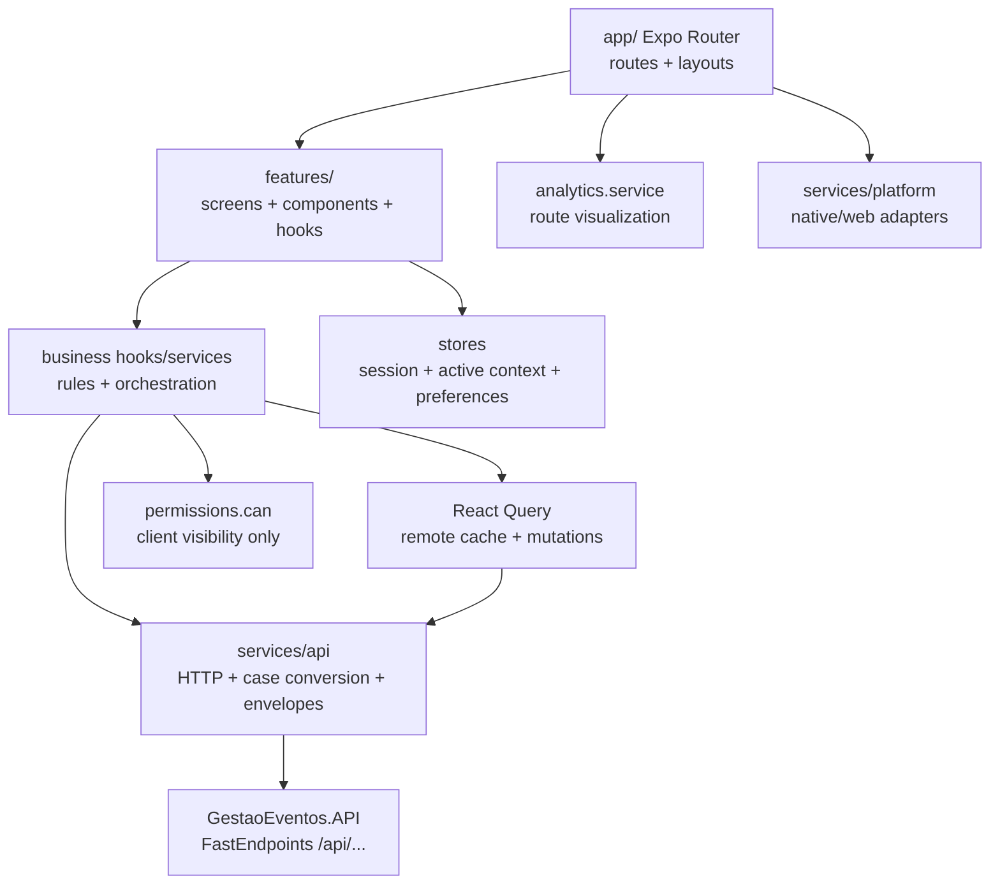
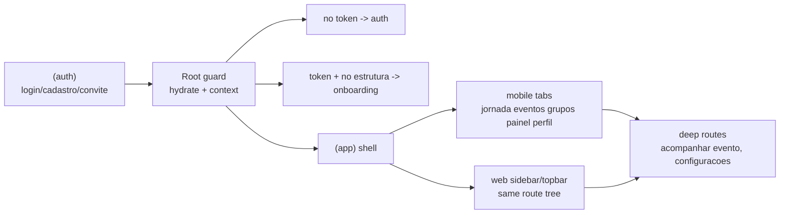
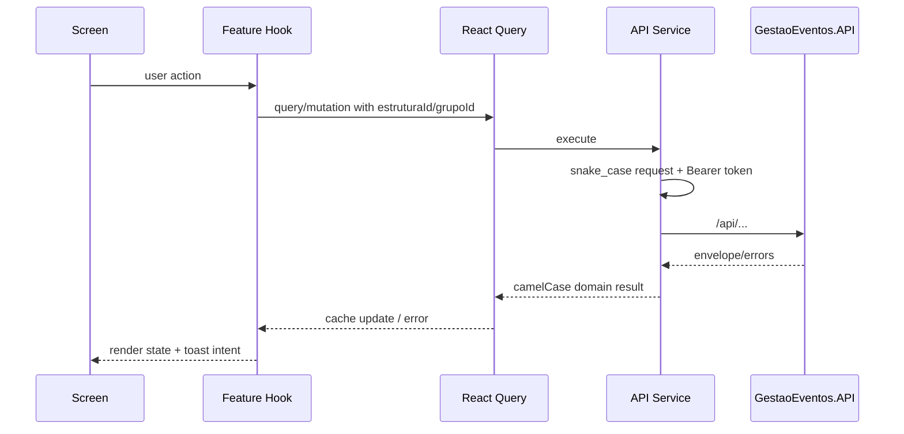

# Architecture Spine - GestaoEventos React App

## Design Paradigm

Feature-Sliced Layered Client sobre Expo universal.



## Invariants & Rules

### AD-1 - Expo Universal App

- **Binds:** all React client work.
- **Prevents:** separate web and mobile clients drifting in routes, state, API use, and UX behavior.
- **Rule:** `GestaoEventos.React` is an Expo universal app for Android, iOS, and web. Platform differences must be isolated behind adapters or responsive shell/components, not separate product implementations.

### AD-2 - Parallel Migration Until Full Parity

- **Binds:** release strategy, backend compatibility, migration planning.
- **Prevents:** big-bang rewrite risk and premature replacement of the working Angular product.
- **Rule:** Angular remains production baseline until React passes the critical parity gate. Backend changes made during coexistence must remain backward-compatible with Angular unless a coordinated cutover story explicitly removes Angular dependency.

### AD-3 - Feature-Sliced Layered Boundaries

- **Binds:** all source organization and feature implementation.
- **Prevents:** screens calling HTTP directly, duplicated remote caches, and business rules scattered through UI components.
- **Rule:** routes/layouts compose; features own screens/components/hooks; business hooks/services orchestrate rules and cache invalidation; API services perform HTTP, request/response normalization, and no business decisions; Zustand stores only session, active context, preferences, and other true global client state; React Query owns remote server data.

### AD-4 - Existing Backend Contract, No BFF

- **Binds:** API client, endpoint use, deployment coexistence.
- **Prevents:** inheriting ManagerPerson `/api/v1`, adding a duplicate contract layer, or breaking Angular through API reshaping.
- **Rule:** React calls GestaoEventos.API endpoints directly at `/api/...`. `EXPO_PUBLIC_API_URL` contains only the host/base URL with no trailing `/api`; API services append `/api/<resource>`, add `Authorization: Bearer <token>`, serialize outgoing payloads/query params to `snake_case`, deserialize responses to `camelCase`, and normalize existing envelopes such as `data`, pagination, and error payloads.

### AD-5 - Auth, Active Context, and Permission Authority

- **Binds:** auth, context switcher, route guards, permissions, query keys.
- **Prevents:** stale sessions, cross-structure leakage, and client-only authorization.
- **Rule:** JWTs live behind the secure-storage adapter backed by `expo-secure-store`; active context lives in Zustand with local persistence. Login and session hydration call `GET /api/contexto/inicial` with query `usuario_id` and must receive a valid context envelope before authenticated routes render. `/api/auth/context` is not the default hydrate contract unless a later story verifies and adopts that endpoint explicitly. UI may hide/disable actions from known permissions, but backend responses remain the authority; owner bypass is not reimplemented as scattered client-only logic.

### AD-6 - One Route Tree, Responsive Shells

- **Binds:** routing, navigation, deep links, web/mobile parity.
- **Prevents:** duplicated routes per platform and different flows for the same capability.
- **Rule:** Expo Router uses `app/(auth)` for public/auth flows and `app/(app)` for authenticated flows. Mobile primary tabs are `jornada`, `eventos`, `grupos`, `painel`, and `perfil`. Web/tablet-large render the same routes in the admin shell with topbar/sidebar. Details, admin-only pages, and deep workflows remain routable outside the visible tab bar.

### AD-7 - GestaoEventos Design System Is Visual Source

- **Binds:** tokens, base components, screen layout, copy tone.
- **Prevents:** importing the dark/lime fitness identity from ManagerPerson.
- **Rule:** React uses the GestaoEventos visual language: brand blue `#0066FF`, light SaaS/admin surfaces, semantic state colors, 8px spacing rhythm, accessible focus states, agnostic terminology, dense operational layouts, and mobile cards/sheets where tables would not fit. ManagerPerson is a technical reference only.

### AD-8 - Port by Feature Slice, Not Template Conversion

- **Binds:** implementation stories and acceptance checks.
- **Prevents:** mechanical Angular-to-React transliteration and unusable mobile tables/forms.
- **Rule:** each React feature starts from the equivalent Angular route/component/service plus the real backend endpoint. UI is reimplemented in React Native components. New TypeScript models/contracts live in React. If docs conflict with running code, current Angular/backend behavior wins until product explicitly changes it.

### AD-9 - Analytics From Scaffold

- **Binds:** route tracking, funnel events, privacy.
- **Prevents:** losing migration funnel data and leaking sensitive labels/values.
- **Rule:** `analytics.service` ships in the scaffold. Web provider pushes the existing `ge_event` contract to `window.dataLayer`; native provider starts as no-op or local queue until the mobile analytics destination is selected. Route changes emit `visualization`; feature flows emit `entrance`, `simulation`, and `confirmation`; restricted or sensitive labels/values never go in `detail`.

### AD-10 - Offline Read-Only First

- **Binds:** React Query cache, mutation UX, future offline stories.
- **Prevents:** conflict-prone queued writes for presence, permissions, checkout, and multi-context state.
- **Rule:** first React release may show recent cached reads with an offline banner. Mutations are blocked while offline. No mutation queue ships until a later feature-specific architecture defines conflict handling, starting only if presence/check-in needs it.

### AD-11 - Platform Adapters for Divergent Capabilities

- **Binds:** storage, analytics, notifications, haptics, sharing, native/web APIs.
- **Prevents:** native imports breaking web and platform branches scattered through feature code.
- **Rule:** platform-specific behavior lives behind `services/platform/*` or an equivalent adapter boundary with one feature-facing contract. Features must not import native-only modules directly unless the file itself is platform-specific.

### AD-12 - Environment Configuration Must Fail Loudly

- **Binds:** API config, build profiles, deployment support.
- **Prevents:** published builds silently pointing at localhost and misreporting configuration errors as login/connectivity failures.
- **Rule:** production/preview builds require `EXPO_PUBLIC_API_URL`. Development may use an explicit local fallback. Missing API configuration outside development must surface a visible blocking notice and a clear error message.

### AD-13 - Parity Gate Controls Go-Live

- **Binds:** QA, release, sprint acceptance, cutover.
- **Prevents:** releasing a partial app because it builds.
- **Rule:** public release requires route/flow parity against the Angular baseline, React build, typecheck, lint, and smoke E2E for login, context hydration, structure switch, jornada, event/presence flow, and at least one guarded admin path. API use must be verified against real backend route classes and Angular service behavior, not stale documentation.

### AD-14 - Canonical Client Contracts

- **Binds:** API services, shared types, business hooks, test fixtures.
- **Prevents:** each feature inventing its own response envelope, pagination shape, error parser, enum strings, context shape, and permission shape.
- **Rule:** before feature slices consume backend data, `GestaoEventos.React` defines canonical client contracts in `shared/types` and `services/api`: API envelope, paged result, normalized API error, initial context, active context, structure summary, group summary, permission model, and shared enums. API services may tolerate backend legacy fields such as `estrutua_id`, but React-facing types expose only the canonical camelCase field `estruturaId`.

### AD-15 - Query Key and Context Invalidation Protocol

- **Binds:** React Query usage, context switch, logout, guarded screens.
- **Prevents:** stale data from a previous structure/group and inconsistent cache invalidation across features.
- **Rule:** all queries use a central key factory under `services/api/query-keys.ts`. Structure-scoped keys include `estruturaId`; group-scoped keys include both `estruturaId` and `grupoId`; detail keys include the server id only after the active scope segment. Changing structure cancels in-flight scoped queries, removes cached scoped details from the previous structure, clears invalid `grupoId`, re-fetches `GET /api/contexto/inicial`, and only then renders protected app routes.

### AD-16 - Permission Facade

- **Binds:** menus, buttons, guarded routes, feature commands.
- **Prevents:** role-name checks, duplicated owner-bypass assumptions, and inconsistent action visibility.
- **Rule:** all client-side authorization checks go through `can(action, resource, scope)` in `services/permissions`. The facade reads hydrated context/permissions and returns only UI visibility/enablement decisions. Backend authorization failures are still handled as authoritative results, and feature components must not check raw role names directly.

### AD-17 - Parity Manifest Is the Release Ledger

- **Binds:** migration stories, QA, release sign-off.
- **Prevents:** subjective parity claims and untracked gaps between Angular, React, backend, analytics, and tests.
- **Rule:** `GestaoEventos.React/docs/parity-manifest.md` is required from the scaffold. Each implemented route/flow records the React route, Angular source route/component, Angular service source, backend endpoint/class, permission checks, analytics events, smoke/regression tests, current status, and known gaps. A route cannot count toward release parity unless its manifest row is verified.

### AD-18 - Operational Envelope

- **Binds:** deploy, EAS, web hosting, CORS, OTA updates, support.
- **Prevents:** a locally working app with no safe path to preview, production, rollback, or support diagnostics.
- **Rule:** the React app has explicit `dev`, `preview`, and `prod` lanes. `preview` and `prod` builds cannot use localhost; web origins must be registered in backend CORS; EAS Build/Update profiles are versioned with the app; OTA updates are allowed only for JS-only fixes that pass smoke tests and do not change API contracts, auth, context, or permissions; production release requires a rollback path and minimal telemetry/error logging.

## Consistency Conventions

| Concern | Convention |
| --- | --- |
| Source root | `GestaoEventos.React/` inside this repo. |
| Domain naming | Keep product-generic terms: `estrutura`, `grupo`, `evento`, `participante`, `responsavel`, `papel`, `permissao`. Context-specific labels are data. |
| Feature paths | `features/<dominio>/screens`, `features/<dominio>/components`, `features/<dominio>/hooks`, `features/<dominio>/types`. |
| API services | `services/api/<dominio>.api.ts`; no API call from `app/` or visual components. |
| API client | `services/api/client.ts` owns base URL, Bearer token, case conversion, envelope normalization, and error normalization. |
| Client contracts | `shared/types/api.ts`, `shared/types/context.ts`, `shared/types/permissions.ts`, and feature-local domain types. |
| Business hooks | `features/<dominio>/hooks/use<Capability>.ts` or `services/<dominio>.service.ts` when reused across features. |
| Stores | `stores/auth.store.ts`, `stores/context.store.ts`, `stores/preferences.store.ts`; no server collections duplicated in Zustand. |
| Query keys | Created only through `services/api/query-keys.ts`; include active scope segments before entity ids. |
| Case conversion | `toSnakeCase` at request/query boundary; `toCamelCase` at response boundary. |
| Errors | API service preserves server error detail; business layer maps it to actionable UI messages without masking operational failures as empty success. |
| Permissions | UI checks call `can(action, resource, scope)`; components do not branch on raw role names. |
| Forms | React Hook Form + Zod for complex forms; submit calls business hook/service, never Axios directly. |
| Tables on mobile | Desktop tables become cards, accordions, or sheets under mobile breakpoints. |
| Analytics detail | `snake_case`, no IDs in `detail`; dynamic IDs/counts in `extra`; no sensitive values. |
| Documentation | Feature stories update `docs/parity-manifest.md` in the same change as route/API work. |

## Stack

| Name | Version |
| --- | --- |
| Node.js | 22.13.x minimum for Expo SDK 57 |
| Expo SDK | 57.x |
| Expo | ^57.0.0, resolved through `expo install` and `expo doctor` |
| Expo Router | ~57.0.x |
| React | 19.2.3 |
| React DOM | 19.2.3 |
| React Native | 0.86.x, SDK 57 compatible |
| React Native Web | 0.21.x |
| TypeScript | ~6.0.3 |
| Expo SecureStore | ~57.0.x |
| Expo Notifications | ~57.0.x |
| Expo Updates | ~57.0.x |
| Expo Vector Icons | ^15.0.x |
| React Native Safe Area Context | ~5.7.x |
| TanStack React Query | ^5.x |
| Zustand | ^5.x |
| Axios | ^1.x |
| React Hook Form | ^7.x |
| @hookform/resolvers | ^3.9.x |
| Zod | ^3.23.x |
| ESLint Config Expo | ~57.0.x |

Stack rule: scaffold with the current Expo SDK 57 starter, then install Expo-managed packages with `npx expo install` and run `npx expo doctor`. ManagerPerson can seed package choices, but Expo's SDK compatibility matrix wins over raw npm latest versions.

## Structural Seed

```text
GestaoEventos.React/
  app/
    _layout.tsx
    (auth)/
      _layout.tsx
      login.tsx
      cadastro.tsx
      recuperar-senha.tsx
      redefinir-senha.tsx
      confirmar-email.tsx
      aceitar-convite.tsx
      sso-callback.tsx
    (app)/
      _layout.tsx
      jornada.tsx
      eventos/
        index.tsx
        iniciar.tsx
        meus.tsx
        acompanhar/[id].tsx
      grupos/
        index.tsx
        [id].tsx
      painel/
        index.tsx
        cockpit.tsx
      perfil.tsx
      configuracoes/
        index.tsx
        membros.tsx
        papeis.tsx
        permissoes.tsx
        planos.tsx
        assinatura.tsx
        tipos-grupo.tsx
        tipos-evento.tsx
        auditoria.tsx
  features/
    auth/
    contexto/
    jornada/
    eventos/
    grupos/
    painel/
    configuracoes/
  services/
    api/
      client.ts
      query-keys.ts
      auth.api.ts
      contexto.api.ts
      eventos.api.ts
      grupos.api.ts
    analytics/
      analytics.service.ts
    permissions/
      can.ts
    platform/
      secure-storage/
      analytics-provider/
      network/
      notifications/
  stores/
    auth.store.ts
    context.store.ts
    preferences.store.ts
  shared/
    components/
    design/
      tokens.ts
    types/
      api.ts
      context.ts
      permissions.ts
    utils/
      case.ts
      query-params.ts
  docs/
    parity-manifest.md
  tests/
    e2e/
    smoke/
```





## Client Contract Seed

| Contract | Owner | Initial Rule |
| --- | --- | --- |
| API envelope | `shared/types/api.ts` | Normalize `{ data }`, paged results, and server errors before feature hooks receive them. |
| Context | `shared/types/context.ts` | Hydrated from `GET /api/contexto/inicial?usuario_id=...`; expose `estruturaId`, never `estrutuaId`, to React features. |
| Permissions | `shared/types/permissions.ts` and `services/permissions/can.ts` | Represent action/resource/scope; no component checks role strings. |
| Query keys | `services/api/query-keys.ts` | Domain first, active scope second, entity id after scope. |
| API errors | `services/api/client.ts` | Preserve status, server code/message, validation errors, and raw response for diagnostics. |

## Parity Manifest Seed

`GestaoEventos.React/docs/parity-manifest.md` starts with this schema:

| Field | Meaning |
| --- | --- |
| React route or flow | Expo Router path or named workflow. |
| Angular source | Route/component/service from the current Angular app. |
| Backend contract | Endpoint route and FastEndpoints request/response class. |
| Context scope | Required `estruturaId`, `grupoId`, or global scope. |
| Permissions | `can(action, resource, scope)` checks and backend authority notes. |
| Analytics | Required `visualization`, `entrance`, `simulation`, `confirmation` events. |
| Tests | Smoke/E2E/regression coverage proving parity. |
| Status | `not-started`, `in-progress`, `verified`, `deferred`. |
| Gaps | Explicit delta accepted for this stage. |

## Operational Seed

| Lane | Rule |
| --- | --- |
| dev | May use explicit local API fallback; logs configuration clearly. |
| preview | Requires public/staging API URL, matching backend CORS origin, EAS profile, and smoke tests. |
| prod | Requires public API URL, no localhost fallback, store/web release checklist, rollback path, and parity manifest fully verified for release scope. |
| web | Hosted origin must be registered in backend CORS and analytics provider. |
| native | Store builds use EAS profiles and secure storage adapter; OTA updates follow AD-18. |

## Capability -> Architecture Map

| Area | Lives in | Governed by |
| --- | --- | --- |
| Auth, signup, recovery, SSO, invite acceptance | `app/(auth)`, `features/auth`, `services/api/auth.api.ts` | AD-3, AD-4, AD-5, AD-6, AD-12 |
| Session hydration and active context | `stores/auth.store.ts`, `stores/context.store.ts`, `features/contexto`, `services/api/contexto.api.ts` | AD-5, AD-14, AD-15 |
| Shell and navigation | `app/(app)/_layout.tsx`, `shared/components/layout` | AD-1, AD-6, AD-7 |
| Jornada | `app/(app)/jornada.tsx`, `features/jornada` | AD-3, AD-8, AD-13, AD-17 |
| Eventos, meus eventos, iniciar, acompanhar, presença | `app/(app)/eventos`, `features/eventos` | AD-3, AD-4, AD-5, AD-8, AD-10, AD-13, AD-15, AD-17 |
| Grupos, membros, hierarquia | `app/(app)/grupos`, `features/grupos` | AD-3, AD-5, AD-7, AD-8, AD-15, AD-16 |
| Painel/cockpit/relatórios operacionais | `app/(app)/painel`, `features/painel` | AD-3, AD-4, AD-7, AD-9, AD-15 |
| Configurações administrativas | `app/(app)/configuracoes`, `features/configuracoes` | AD-5, AD-6, AD-8, AD-13, AD-16, AD-17 |
| Analytics | `services/analytics`, `services/platform/analytics-provider` | AD-9, AD-11 |
| Offline state | `services/platform/network`, React Query defaults, shared banner | AD-10 |
| App release/cutover | parity manifest, smoke tests, CI scripts, EAS/web lanes | AD-2, AD-13, AD-17, AD-18 |

## Deferred

| Decision | Why It Can Wait |
| --- | --- |
| Mobile analytics provider after no-op/local queue | The web GTM contract is enough for parity instrumentation; native destination can be selected before store release. |
| Push notification provider and token registration | Notifications exist conceptually, but parity can start with in-app/web behavior and platform adapter contracts. |
| Offline mutation queue for check-in/presence | Requires conflict semantics by event/occurrence/participant; unsafe to decide at initiative level without a dedicated story. |
| Generated API client/OpenAPI contract package | Current backend route classes are source of truth; generation can be introduced later without changing feature boundaries. |
| Angular retirement plan | Controlled by parity gate and business release timing, not by initial app architecture. |
| Store account identifiers and public rollout calendar | Operational lanes are fixed; exact store metadata and rollout date belong to release planning. |
