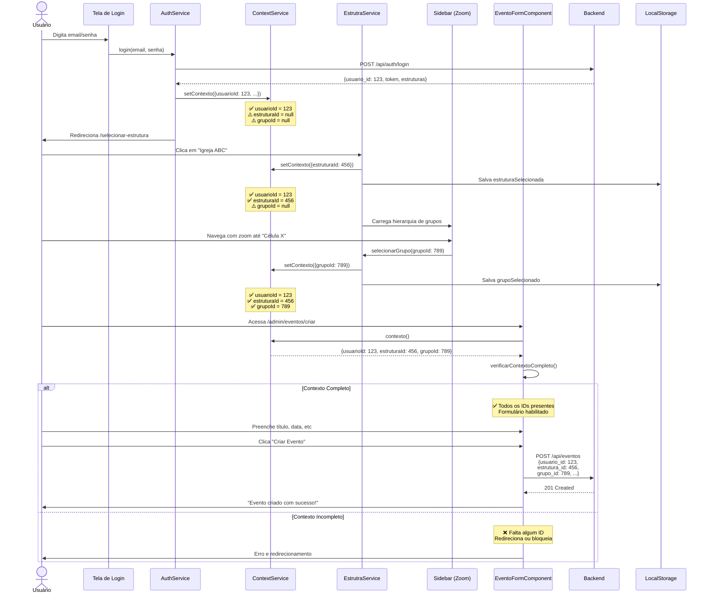

# Fluxo de Contexto: Como os IDs São Preenchidos

**Objetivo**: Explicar visualmente como `usuario_id`, `estrutura_id` e `grupo_id` chegam no formulário de evento.

---

## 📊 Diagrama de Fluxo



---

## 🔄 Resumo do Fluxo

### 1️⃣ **Login** → `usuarioId`

```typescript
// auth.service.ts
login(email, senha).subscribe(response => {
  this.contextService.setContexto({
    usuarioId: response.usuario_id,  // ✅ PREENCHE AQUI
    token: response.token,
    estruturas: response.estruturas,
    estruturaId: null,
    grupoId: null
  });
});
```

**Resultado**: `contexto.usuarioId = 123` ✅

---

### 2️⃣ **Seleção de Estrutura** → `estruturaId`

```typescript
// estrutura.service.ts
selecionarEstrutura(estrutura: Estrutura): void {
  localStorage.setItem('estruturaSelecionada', JSON.stringify(estrutura));
  
  const ctx = this.contextService.contexto();
  this.contextService.setContexto({
    ...ctx,
    estruturaId: estrutura.id  // ✅ PREENCHE AQUI
  });
}
```

**Resultado**: `contexto.estruturaId = 456` ✅

---

### 3️⃣ **Navegação com Zoom** → `grupoId`

```typescript
// estrutura.service.ts (chamado pela Sidebar)
selecionarGrupo(grupo: Grupo): void {
  localStorage.setItem('grupoSelecionado', JSON.stringify(grupo));
  
  const ctx = this.contextService.contexto();
  this.contextService.setContexto({
    ...ctx,
    grupoId: grupo.id  // ✅ PREENCHE AQUI
  });
  
  this.grupoSelecionadoSubject.next(grupo);
}
```

**Resultado**: `contexto.grupoId = 789` ✅

---

### 4️⃣ **Formulário de Evento** → Usa os IDs

```typescript
// evento-form.component.ts
ngOnInit(): void {
  this.verificarContextoCompleto();  // ✅ Valida TUDO está preenchido
}

onSubmit(): void {
  const contexto = this.contextService.contexto();
  const estrutura = this.estruturaService.estruturaSelecionada();
  const grupo = this.estruturaService.grupoSelecionado();

  const request = {
    usuario_id: contexto.usuarioId,      // 123 ✅
    estrutura_id: estrutura.id,          // 456 ✅
    grupo_id: grupo.id,                  // 789 ✅
    // ... resto dos campos
  };

  this.eventoService.create(request).subscribe(...);
}
```

---

## ⚠️ Validações Necessárias

### No `evento-form.component.ts`:

```typescript
private verificarContextoCompleto(): void {
  const contexto = this.contextService.contexto();
  const estrutura = this.estruturaService.estruturaSelecionada();
  const grupo = this.estruturaService.grupoSelecionado();

  // 1. Verificar login
  if (!contexto?.usuarioId) {
    this.erro.set('❌ Você precisa estar logado');
    this.router.navigate(['/login']);
    return;
  }

  // 2. Verificar estrutura
  if (!estrutura?.id) {
    this.erro.set('⚠️ Selecione uma estrutura primeiro');
    this.router.navigate(['/selecionar-estrutura']);
    return;
  }

  // 3. Verificar grupo
  if (!grupo?.id) {
    this.erro.set('⚠️ Use o navegador hierárquico para selecionar um grupo');
    this.form.disable();
    return;
  }

  // ✅ Tudo OK
  console.log('[EventoForm] Contexto completo:', {
    usuarioId: contexto.usuarioId,
    estruturaId: estrutura.id,
    grupoId: grupo.id
  });
}
```

---

## 🧪 Como Testar Cada Fase

### Teste 1: Login Preenche `usuarioId`
```bash
1. Abra DevTools > Console
2. Faça login
3. Verifique: console.log(this.contextService.contexto())
   Esperado: { usuarioId: 123, estruturaId: null, grupoId: null }
```

### Teste 2: Seleção Preenche `estruturaId`
```bash
1. Selecione uma estrutura
2. Verifique: console.log(this.contextService.contexto())
   Esperado: { usuarioId: 123, estruturaId: 456, grupoId: null }
```

### Teste 3: Zoom Preenche `grupoId`
```bash
1. Navegue pela hierarquia (zoom)
2. Clique em um grupo
3. Verifique: console.log(this.contextService.contexto())
   Esperado: { usuarioId: 123, estruturaId: 456, grupoId: 789 }
```

### Teste 4: Formulário Usa os IDs
```bash
1. Acesse /admin/eventos/criar
2. Preencha formulário
3. Abra DevTools > Network
4. Clique "Criar Evento"
5. Verifique request payload:
   {
     "usuario_id": 123,
     "estrutura_id": 456,
     "grupo_id": 789,
     ...
   }
```

---

## 🐛 Troubleshooting

### Problema: `usuario_id: null`
**Causa**: Login não está preenchendo contexto  
**Solução**: Verificar `auth.service.ts` → `setContexto()` após login

### Problema: `estrutura_id: null`
**Causa**: Seleção de estrutura não está atualizando contexto  
**Solução**: Verificar `estrutura.service.ts` → `selecionarEstrutura()`

### Problema: `grupo_id: null`
**Causa**: Navegação (zoom) não está disparando `selecionarGrupo()`  
**Solução**: Verificar se Sidebar chama `estruturaService.selecionarGrupo()`

### Problema: Formulário abre mas IDs são `null`
**Causa**: Não está validando contexto no `ngOnInit()`  
**Solução**: Adicionar `verificarContextoCompleto()` no `ngOnInit()`
