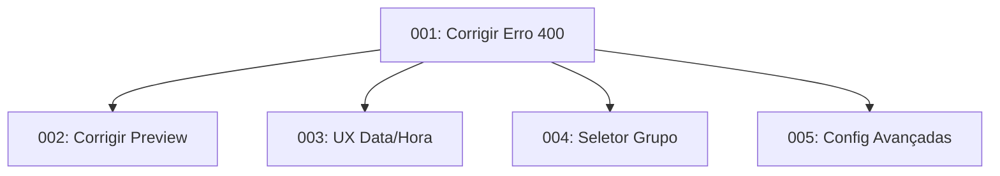

# Plano de Implementação - evento-form-improvements

**Feature**: 001-evento-form-improvements  
**Data**: 31/01/2026  
**Duração Total**: 5 dias

---

## 📋 Visão Geral

Este plano detalha a ordem de implementação das 5 tarefas para corrigir bugs e melhorias UX no formulário de criar eventos.

---

## 🔴 Fase 1: Bugs Críticos (1.5 dias)

### Dia 1: Task 001 - Corrigir Erro 400

**Status**: 🔴 BLOQUEADOR - Fazer PRIMEIRO  
**Arquivo**: [001-corrigir-erro-400.md](tasks/001-corrigir-erro-400.md)  
**Duração**: 1 dia

**Por quê primeiro?**
- Atualmente NENHUM evento pode ser criado (erro 400)
- Bloqueia TODAS as outras tarefas
- Sem isso, não há como testar as outras melhorias

**Checklist Rápido:**
- [ ] Incluir `usuario_id`, `estrutura_id`, `grupo_id` no request
- [ ] Usar formato ISO 8601 nas datas
- [ ] Usar snake_case nos campos
- [ ] Testar criação básica funcionando

---

### Dia 1.5: Task 002 - Corrigir Preview

**Status**: 🔴 BUG CRÍTICO  
**Arquivo**: [002-corrigir-preview-ocorrencias.md](tasks/002-corrigir-preview-ocorrencias.md)  
**Duração**: 0.5 dia

**Por quê segundo?**
- Bug simples mas visível (quebra confiança do usuário)
- Rápido de corrigir (apenas 1 função)
- Independente das outras tarefas

**Checklist Rápido:**
- [ ] Corrigir lógica de `Math.min(5, ...)`
- [ ] Respeitar limite definido pelo usuário
- [ ] Adicionar indicação "... e mais X ocorrências"

---

## 🟡 Fase 2: UX Crítica (2 dias)

### Dias 2-3: Task 003 - Melhorar UX Data/Hora

**Status**: 🟡 UX CRÍTICA  
**Arquivo**: [003-melhorar-ux-data-hora.md](tasks/003-melhorar-ux-data-hora.md)  
**Duração**: 2 dias

**Por quê terceiro?**
- UX confusa afeta TODOS os usuários
- Requer refatoração maior (FormGroup, template, CSS)
- Precisa da Task 001 funcionando para testar

**Checklist Rápido:**
- [ ] Separar seções "QUANDO ACONTECE?" e "REPETIR?"
- [ ] Usar PrimeNG Calendar
- [ ] Campos separados: data, hora, duração
- [ ] Cálculo automático de fim
- [ ] Responsivo

---

## 🟢 Fase 3: Features Faltando (1.5 dias)

### Dia 4: Task 004 - Seletor de Grupo

**Status**: 🟢 FEATURE NOVA  
**Arquivo**: [004-adicionar-seletor-grupo.md](tasks/004-adicionar-seletor-grupo.md)  
**Duração**: 0.5 dia

**Por quê quarto?**
- Feature simples mas importante
- Aumenta flexibilidade do sistema
- Rápido de implementar com PrimeNG

**Checklist Rápido:**
- [ ] Radio buttons "Grupo" vs "Todos"
- [ ] Dropdown de grupos com filtro
- [ ] Validação condicional
- [ ] Usar grupoRaizId para "Todos"

---

### Dia 4.5-5: Task 005 - Configurações Avançadas

**Status**: 🟢 FEATURE NOVA (Menor prioridade)  
**Arquivo**: [005-adicionar-configuracoes-avancadas.md](tasks/005-adicionar-configuracoes-avancadas.md)  
**Duração**: 1 dia

**Por quê último?**
- Backend já suporta, mas não é urgente
- Colapsável por padrão (não atrapalha UX)
- Pode ser adiado se necessário

**Checklist Rápido:**
- [ ] Seção colapsável
- [ ] 9 checkboxes de permissões
- [ ] Lógica condicional (justificativa)
- [ ] Enviar em snake_case

---

## 📊 Resumo por Prioridade

| Prioridade | Task | Tempo | Racional |
|------------|------|-------|----------|
| P0 🔴 | 001 - Corrigir Erro 400 | 1d | **BLOQUEADOR** - Sem isso, nada funciona |
| P0 🔴 | 002 - Corrigir Preview | 0.5d | **BUG CRÍTICO** - Quebra confiança |
| P1 🟡 | 003 - UX Data/Hora | 2d | **UX CRÍTICA** - Afeta todos os usuários |
| P2 🟢 | 004 - Seletor Grupo | 0.5d | **FEATURE** - Aumenta flexibilidade |
| P3 🟢 | 005 - Config Avançadas | 1d | **FEATURE** - Nice-to-have |

**TOTAL**: 5 dias

---

## ⚠️ Dependências

- **001 (Erro 400)** bloqueia TUDO
- **002, 003, 004, 005** são independentes entre si (após 001)

---

## 🎯 Entregas por Dia

### Dia 1 (Manhã)
- [ ] 001: Implementar envio correto de IDs
- [ ] 001: Testar criação básica funcionando
- [ ] 001: Validação de contexto

### Dia 1 (Tarde)
- [ ] 002: Corrigir lógica de preview
- [ ] 002: Adicionar indicação de total
- [ ] 002: Testar com 3, 10, 50 ocorrências

### Dia 2 (Manhã)
- [ ] 003: Instalar PrimeNG Calendar
- [ ] 003: Refatorar FormGroup
- [ ] 003: Separar seções no template

### Dia 2 (Tarde)
- [ ] 003: Implementar cálculo de duração
- [ ] 003: CSS e responsividade

### Dia 3
- [ ] 003: Testes completos
- [ ] 003: Ajustes finais

### Dia 4 (Manhã)
- [ ] 004: Implementar seletor de grupo
- [ ] 004: Testar com filtro

### Dia 4 (Tarde) + Dia 5
- [ ] 005: Seção colapsável de permissões
- [ ] 005: Lógica condicional
- [ ] 005: Testes finais

---

## ✅ Critérios de Conclusão Geral

- [ ] Evento pode ser criado sem erro 400
- [ ] Preview mostra quantidade correta
- [ ] UX de data/hora é intuitiva
- [ ] Pode escolher grupo ou "Todos"
- [ ] Permissões podem ser configuradas
- [ ] Formulário é responsivo
- [ ] Todos os cenários de teste passam
- [ ] Backend recebe dados corretos

---

## 🚀 Próximos Passos

Após concluir todas as 5 tarefas:

1. **Testes de Integração**: Criar evento completo com todas as features
2. **Review de UX**: Pedir feedback de 2-3 usuários reais
3. **Documentação**: Atualizar guia do usuário
4. **Deploy**: Mover para produção após aprovação

---

## 📝 Notas

- **Pode paralelizar**: Tasks 002, 003, 004, 005 são independentes (após 001)
- **Pode adiar**: Task 005 (config avançadas) se ficar sem tempo
- **Não pode pular**: Task 001 (erro 400) é obrigatória
