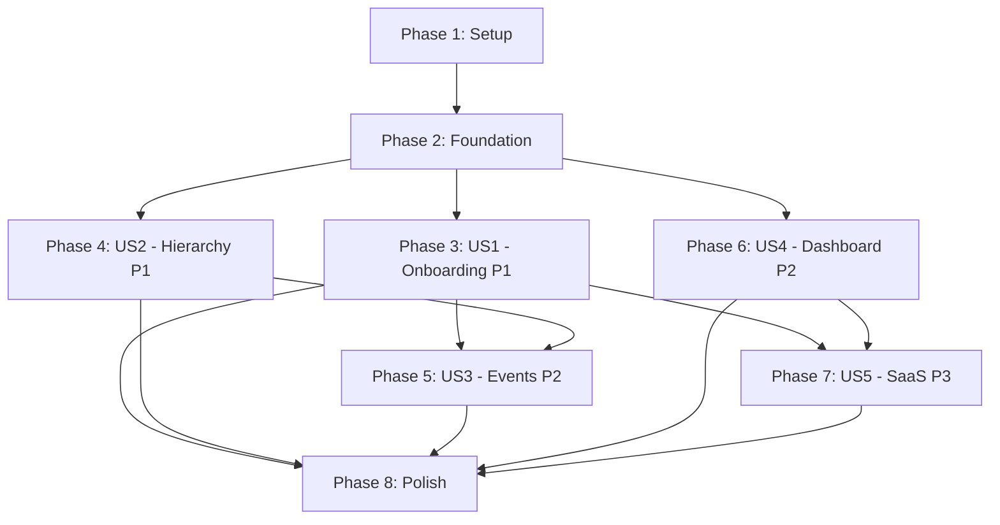

# Tasks: UX & SaaS Platform Enhancements

**Input**: spec.md (35 FRs clarificados), plan.md (arquitetura detalhada), ux-analysis-summary.md  
**Branch**: `003-ux-saas-improvements`  
**Prerequisites**: plan.md ✅, spec.md ✅, constitution.md ✅

**Tests**: Incluídos conforme especificação (E2E com Playwright, testes de integração)

**Organization**: Tasks organizadas por user story para implementação e testes independentes

## Format: `- [ ] [ID] [P?] [Story?] Description with file path`

- **[P]**: Pode ser paralelo (arquivos diferentes, sem dependências)
- **[Story]**: User Story (US1, US2, US3, US4, US5)
- Task IDs sequenciais (T001, T002...)
- Paths exatos de arquivos incluídos

---

## Phase 1: Setup (Infraestrutura Compartilhada)

**Purpose**: Inicialização do projeto e dependências necessárias para todas as features

- [ ] T001 ⚠️ BLOCKED: Mercado Pago SDK - Research completed, REST API approach decided (see research.md), implementation moved to Phase 2 Foundation
- [X] T002 [P] Instalar ngx-translate no frontend: `npm install @ngx-translate/core @ngx-translate/http-loader`
- [X] T003 [P] Pesquisar e instalar biblioteca de org chart ✅ **DECISION**: PrimeNG OrganizationChart (already installed at primeng@19.1.3) - See research.md
- [ ] T004 ⚠️ BLOCKED: Configurar Mercado Pago credentials - Depends on T001, moved to Phase 2 after MercadoPagoService implementation
- [X] T005 [P] Configurar ngx-translate em `GestaoEventos.Angular/src/app/app.config.ts` com defaultLanguage='pt-br'
- [X] T006 [P] Criar arquivo de traduções `assets/i18n/pt-br.json` com estrutura inicial (300+ translation keys)

---

## Phase 2: Foundational (Pré-requisitos Bloqueadores)

**Purpose**: Infraestrutura core que DEVE estar completa antes de qualquer user story

**⚠️ CRITICAL**: Nenhum trabalho de user story pode começar até esta fase estar completa

### Backend Foundation

- [X] T007 Criar migration `AddSubscriptionTables` em `Infrastructure/Data/Migrations/` com tabelas: Subscriptions, InviteCodes, DrillDownContexts, AuditLogs ✅ Script SQL manual criado em AddSubscriptionTables.sql
- [X] T008 Criar SubscriptionAggregate em `Core/Aggregates/SubscriptionAggregate.cs` com lógica de rolling 30-day window
- [X] T009 [P] Criar InviteCodeAggregate em `Core/Aggregates/InviteCodeAggregate.cs` com validação de token e expiração
- [X] T010 [P] Criar DrillDownContextAggregate em `Core/Aggregates/DrillDownContextAggregate.cs` com context stack e permissions
- [X] T011 [P] Criar AuditLogAggregate em `Core/Aggregates/AuditLogAggregate.cs` para compliance logging
- [X] T012 Criar ValueObject EventLimit em `Core/ValueObjects/EventLimit.cs` com lógica de cálculo de 30 dias
- [X] T013 [P] Criar ValueObject HierarchyDepth em `Core/ValueObjects/HierarchyDepth.cs` com limite máximo de 6 níveis
- [X] T014 [P] Criar ValueObject PlanType em `Core/ValueObjects/PlanType.cs` com enum Free/Pro/Enterprise
- [X] T015 Criar PermissionConflictResolver em `Core/Services/PermissionConflictResolver.cs` com regra "most restrictive wins"
- [X] T016 [P] Criar HierarchyTraversalService em `Core/Services/HierarchyTraversalService.cs` para navegação em árvore (versão simplificada)
- [X] T017 Implementar repositories: ISubscriptionRepository, IInviteCodeRepository, IDrillDownContextRepository, IAuditLogRepository em `Core/Interfaces/`
- [X] T018 Implementar concrete repositories em `Infrastructure/Repositories/` com EF Core
- [X] T019 Criar MercadoPagoService em `Infrastructure/Services/MercadoPagoService.cs` com métodos de criação de preference e webhook validation (REST API)
- [X] T020 [P] Criar AuditLogService em `Infrastructure/Services/AuditLogService.cs` com logging assíncrono (fire-and-forget)
- [X] T021 Aplicar migration: ✅ Script SQL executado manualmente no MySQL
- [X] T022 Criar índices otimizados para queries hierárquicas e rolling window ✅ Já incluídos no migration script (composite indexes)

### Frontend Foundation

- [X] T023 Criar ErrorHandlerInterceptor em `shared/interceptors/error-handler.interceptor.ts` para transformar erros técnicos em mensagens amigáveis (FR-007)
- [X] T024 [P] Criar DrillDownContextInterceptor em `shared/interceptors/drill-down-context.interceptor.ts` para injetar header X-DrillDown-Context
- [X] T025 Criar error mapping enum e translations em `shared/enums/error-codes.enum.ts` e `assets/i18n/pt-br.json`
- [X] T026 [P] Criar SubscriptionGuard em `shared/guards/subscription.guard.ts` para verificar limites de plano (FR-024)
- [X] T027 [P] Criar DrillDownGuard em `shared/guards/drill-down.guard.ts` para validar permissões de drill-down
- [X] T028 Atualizar rota `/estrutura/hierarquia` em routing para corrigir 404 error (FR-009) ✅ Rota adicionada em app.routes.ts
- [X] T029 [P] Criar componentes compartilhados base: PlanBadgeComponent, UpgradePromptComponent, HelpTooltipComponent, ContextHeaderComponent em `shared/components/`

**Checkpoint**: Foundation completa - implementação de user stories pode começar em paralelo ✅

---

## Phase 3: User Story 1 - First-Time User Onboarding (Priority: P1) 🎯 MVP

**Goal**: Novo usuário entende proposta de valor, cria conta, completa onboarding com wizard guiado

**Independent Test**: Navegar para landing page, signup, completar wizard de estrutura sem criar eventos

### Backend - User Story 1

- [ ] T030 [P] [US1] Criar CreateStructureCommand em `UseCases/Onboarding/Commands/CreateStructureCommand.cs` com validation de hierarchy levels
- [ ] T031 [P] [US1] Criar CreateStructureHandler em `UseCases/Onboarding/Commands/CreateStructureHandler.cs` usando MediatR
- [ ] T032 [P] [US1] Criar CompleteOnboardingCommand e Handler em `UseCases/Onboarding/Commands/`
- [ ] T033 [P] [US1] Criar GetOnboardingStatusQuery e Handler em `UseCases/Onboarding/Queries/` para verificar progresso
- [ ] T034 [US1] Criar FastEndpoint CreateStructure em `Web/Onboarding/CreateStructure.cs` (FR-002)
- [ ] T035 [US1] Criar FastEndpoint Complete em `Web/Onboarding/Complete.cs` para finalizar wizard
- [ ] T036 [US1] Criar FastEndpoint GetStatus em `Web/Onboarding/GetStatus.cs` para status do wizard

### Frontend - User Story 1

- [ ] T037 [P] [US1] Criar LandingComponent em `libs/public/landing/landing.component.ts` com sections: hero, features, pricing, testimonials (FR-001)
- [ ] T038 [P] [US1] Criar PricingTiersComponent em `libs/public/landing/components/pricing-tiers/` mostrando Free vs Pro (FR-001)
- [ ] T039 [P] [US1] Criar FeaturesShowcaseComponent em `libs/public/landing/components/features-showcase/` com key features
- [ ] T040 [US1] Criar OnboardingComponent refatorado em `libs/public/onboarding/onboarding.component.ts` como wizard multi-step (FR-003)
- [ ] T041 [US1] Criar WelcomeStepComponent em `libs/public/onboarding/steps/welcome-step/` com 3 opções: Create Structure, Join Invite, Start Free Trial
- [ ] T042 [US1] Criar StructureCreationStepComponent em `libs/public/onboarding/steps/structure-creation-step/` com formulário de níveis hierárquicos customizáveis (FR-014)
- [ ] T043 [US1] Criar GroupSetupStepComponent em `libs/public/onboarding/steps/group-setup-step/` para criar primeiro grupo
- [ ] T044 [US1] Criar CompletionStepComponent em `libs/public/onboarding/steps/completion-step/` com feedback de sucesso
- [ ] T045 [US1] Criar OnboardingApiService em `shared/apis/onboarding-api.service.ts` (Layer 3 - HTTP puro)
- [ ] T046 [US1] Criar OnboardingService em `shared/services/onboarding.service.ts` (Layer 2 - Lógica de wizard state)
- [ ] T047 [US1] Implementar navegação entre steps com progress indicator (Step 1 of 3) e validação por step
- [ ] T048 [US1] Criar rota `/signup` redirecionando para LandingComponent e atualizar link "Solicite acesso" (FR-001)
- [ ] T049 [US1] Adicionar tradução de todas as strings do onboarding em `assets/i18n/pt-br.json`

### Tests - User Story 1

- [ ] T050 [P] [US1] E2E test com Playwright em `cypress/e2e/onboarding-flow.cy.ts`: signup → wizard → criar estrutura com 3 níveis → finalizar
- [ ] T051 [P] [US1] E2E test em `cypress/e2e/free-tier-indicators.cy.ts`: verificar que Free plan mostra "5 eventos/mês - Faça upgrade"

**Checkpoint US1**: Onboarding funcional e testável independentemente ✅

---

## Phase 4: User Story 2 - Hierarchical View & Drill-Down (Priority: P1) 🎯 MVP

**Goal**: Usuário de alto nível visualiza organograma e navega drill-down para ver perspectiva de subordinados

**Independent Test**: Criar estrutura multi-nível com eventos, verificar drill-down e breadcrumbs funcionam

### Backend - User Story 2

- [ ] T052 [P] [US2] Criar GetOrganizationChartQuery em `UseCases/Hierarchy/Queries/GetOrganizationChartQuery.cs` com parâmetro maxDepth (FR-010, FR-015)
- [ ] T053 [P] [US2] Criar GetOrganizationChartHandler em `UseCases/Hierarchy/Queries/` retornando tree structure com subordinates
- [ ] T054 [P] [US2] Criar GetDrillDownContextQuery e Handler em `UseCases/Hierarchy/Queries/` para contexto atual
- [ ] T055 [P] [US2] Criar GetSubordinateEventsQuery e Handler em `UseCases/Hierarchy/Queries/` aplicando permissões e filtering
- [ ] T056 [US2] Criar SetDrillDownContextCommand e Handler em `UseCases/Hierarchy/Commands/` salvando session state (FR-011)
- [ ] T057 [US2] Criar ClearDrillDownContextCommand e Handler em `UseCases/Hierarchy/Commands/` para retornar à própria visão
- [ ] T058 [US2] Criar FastEndpoint GetChart em `Web/Hierarchy/GetChart.cs` (FR-010)
- [ ] T059 [US2] Criar FastEndpoint GetSubordinateEvents em `Web/Hierarchy/GetSubordinateEvents.cs` (FR-011)
- [ ] T060 [US2] Criar FastEndpoint SetDrillDownContext em `Web/Hierarchy/SetDrillDownContext.cs` com validação de permissions (FR-013)
- [ ] T061 [US2] Implementar lógica de permission boundaries em HierarchyTraversalService - usuário só vê escopo autorizado (FR-013)

### Frontend - User Story 2

- [ ] T062 [P] [US2] Criar HierarchyComponent em `libs/adm/hierarchy/hierarchy.component.ts` como container principal
- [ ] T063 [US2] Criar OrgChartComponent em `libs/adm/hierarchy/components/org-chart/` usando biblioteca pesquisada (árvore vertical colapsável conforme clarificação)
- [ ] T064 [US2] Implementar expand/collapse individual por nível no OrgChartComponent com state management
- [ ] T065 [US2] Criar DrillDownBreadcrumbComponent em `libs/adm/hierarchy/components/drill-down-breadcrumb/` mostrando trail navegável (FR-012)
- [ ] T066 [US2] Criar SubordinateViewComponent em `libs/adm/hierarchy/components/subordinate-view/` renderizando dashboard do subordinado
- [ ] T067 [US2] Criar HierarchyApiService em `shared/apis/hierarchy-api.service.ts` (Layer 3 - HTTP)
- [ ] T068 [US2] Criar DrillDownApiService em `shared/apis/drill-down-api.service.ts` (Layer 3 - HTTP)
- [ ] T069 [US2] Criar HierarchyService em `shared/services/hierarchy.service.ts` (Layer 2 - Tree data management e cache)
- [ ] T070 [US2] Criar DrillDownService em `shared/services/drill-down.service.ts` (Layer 2 - Context switching logic, history stack)
- [ ] T071 [US2] Implementar click handler em OrgChartComponent: ao clicar em subordinado → SetDrillDownContext → Navigate para SubordinateView
- [ ] T072 [US2] Implementar navegação breadcrumb: cada nível clicável retorna para aquele contexto
- [ ] T073 [US2] Criar HierarchyModel em `shared/models/hierarchy.model.ts` com interfaces para tree nodes
- [ ] T074 [US2] Criar DrillDownContextModel em `shared/models/drill-down-context.model.ts` com context stack
- [ ] T075 [US2] Adicionar event statistics (eventCount, attendanceRate) em cada nó do org chart (FR-010)
- [ ] T076 [US2] Aplicar DrillDownGuard na rota de hierarchy para validar que apenas superiores podem acessar
- [ ] T077 [US2] Adicionar traduções de hierarchy e drill-down em `assets/i18n/pt-br.json`

### Tests - User Story 2

- [ ] T078 [P] [US2] E2E test em `cypress/e2e/hierarchy-drill-down.cy.ts`: criar estrutura com Pastor → Obreiro → Líder, criar eventos em cada nível, fazer drill-down, verificar breadcrumbs
- [ ] T079 [P] [US2] Integration test no backend `tests/HierarchyQueryTests.cs`: verificar que GetOrganizationChart respeita maxDepth=6 e permissions
- [ ] T080 [P] [US2] Integration test no backend `tests/PermissionBoundaryTests.cs`: usuário nível 3 não consegue ver eventos de nível 1 se não tiver permissão

**Checkpoint US2**: Hierarchy + drill-down funcional e testável independentemente ✅

---

## Phase 5: User Story 3 - Event Creation with Permissions & Aliasing (Priority: P2)

**Goal**: Usuário cria evento, seleciona grupos/usuários, define permissões granulares e nickname do evento

**Independent Test**: Criar evento, atribuir 2 grupos, configurar 3 permissões diferentes, verificar funcionamento para diferentes papéis

### Backend - User Story 3

- [ ] T081 [P] [US3] Adicionar campos novos em Event entity: Alias (string), PermissionFlags (int bitmask), OwnerId (int), IsRecurring (bool), RecurrencePattern (JSON) em `Core/Aggregates/EventAggregate.cs`
- [ ] T082 [US3] Criar migration para adicionar novos campos em Event table
- [ ] T083 [P] [US3] Criar CreateEventWithPermissionsCommand em `UseCases/Events/Commands/` com validation de permissions (FR-016, FR-017, FR-018)
- [ ] T084 [P] [US3] Criar UpdateEventAliasCommand e Handler (FR-017)
- [ ] T085 [P] [US3] Criar TransferEventOwnershipCommand e Handler (FR-020)
- [ ] T086 [US3] Criar GetEventParticipantsTreeQuery e Handler retornando hierarchical tree picker data (FR-016)
- [ ] T087 [US3] Atualizar FastEndpoint Create em `Web/Events/Create.cs` para aceitar permissionFlags e alias
- [ ] T088 [US3] Atualizar FastEndpoint Update em `Web/Events/Update.cs` aplicando validação de permissões antes de permitir edição
- [ ] T089 [US3] Criar FastEndpoint TransferOwnership em `Web/Events/TransferOwnership.cs` (FR-020)
- [ ] T090 [US3] Implementar validação: campos disabled devem retornar erro se tentarem editar com permissão negada

### Frontend - User Story 3

- [ ] T091 [US3] Refatorar EventoFormComponent em `libs/adm/evento/evento-form/` para incluir seções: Basic Info, Participants, Permissions, Schedule (FR-016)
- [ ] T092 [US3] Criar ParticipantsTreePickerComponent em `libs/adm/evento/components/participants-tree-picker/` com checkboxes e search (FR-016)
- [ ] T093 [US3] Criar PermissionsConfigComponent em `libs/adm/evento/components/permissions-config/` com toggles para 4 permissões (FR-018)
- [ ] T094 [US3] Criar EventAliasInputComponent em `libs/adm/evento/components/event-alias-input/` com exemplo: "Célula Vida Nova" (FR-017)
- [ ] T095 [US3] Implementar lógica de disable fields com tooltip explicativo quando permissão negada (FR-018, acceptance 5)
- [ ] T096 [US3] Atualizar EventoApiService em `shared/apis/evento-api.service.ts` com novos métodos: createWithPermissions, updateAlias, transferOwnership
- [ ] T097 [US3] Atualizar EventoService em `shared/services/evento.service.ts` com validation logic e cache invalidation
- [ ] T098 [US3] Criar EventoModel atualizado em `shared/models/evento.model.ts` com campos alias e permissionFlags
- [ ] T099 [US3] Adicionar traduções de event permissions e aliasing em `assets/i18n/pt-br.json`

### Tests - User Story 3

- [ ] T100 [P] [US3] E2E test em `cypress/e2e/event-permissions.cy.ts`: criar evento como Owner, configurar permissões, logar como outro usuário, tentar editar campo restrito, verificar disabled com tooltip
- [ ] T101 [P] [US3] Integration test no backend `tests/EventPermissionTests.cs`: verificar que UpdateEvent com permissão negada retorna erro apropriado

**Checkpoint US3**: Event creation com permissions e aliasing funcional ✅

---

## Phase 6: User Story 4 - Dashboard Context & Quick Actions (Priority: P2)

**Goal**: Dashboard mostra contexto do usuário (nome, papel, estrutura), eventos de hoje, ações rápidas, sem erros técnicos

**Independent Test**: Logar com diferentes papéis, verificar dashboard mostra informações apropriadas e zero erros 500/404

### Backend - User Story 4

- [ ] T102 [P] [US4] Criar GetDashboardContextQuery em `UseCases/Dashboard/Queries/` retornando: userName, role, structure, group, todaysEvents, upcomingEvents, pendingAttendance (FR-005, FR-006)
- [ ] T103 [US4] Criar GetDashboardContextHandler aplicando drill-down context se ativo
- [ ] T104 [US4] Criar FastEndpoint GetDashboardContext em `Web/Dashboard/GetContext.cs`
- [ ] T105 [US4] Garantir que todos os endpoints de dashboard retornam user-friendly errors ao invés de stack traces (FR-007)

### Frontend - User Story 4

- [ ] T106 [US4] Refatorar DashboardComponent em `libs/adm/dashboard/dashboard.component.ts` para carregar context no init
- [ ] T107 [US4] Criar ContextHeaderWidget em `libs/adm/dashboard/widgets/context-header/` mostrando: nome, papel, estrutura atual, grupo atual (FR-005)
- [ ] T108 [US4] Criar TodaysEventsWidget em `libs/adm/dashboard/widgets/todays-events/` com quick actions: View Details, Mark Attendance, Edit (FR-006)
- [ ] T109 [US4] Criar UpcomingEventsWidget em `libs/adm/dashboard/widgets/upcoming-events/` mostrando próximos 7 dias com acesso rápido
- [ ] T110 [US4] Criar PendingAttendanceWidget em `libs/adm/dashboard/widgets/pending-attendance/` destacando "3 eventos aguardando confirmação"
- [ ] T111 [US4] Implementar empty states: "Nenhum evento hoje" com CTA "Criar Evento" (FR-006, acceptance 2)
- [ ] T112 [US4] Aplicar ErrorHandlerInterceptor globalmente para transformar todos os erros em mensagens amigáveis (FR-007)
- [ ] T113 [US4] Adicionar retry button em error messages "Não foi possível carregar. [Tentar novamente]" (FR-007, acceptance 5)
- [ ] T114 [US4] Atualizar DashboardService em `shared/services/dashboard.service.ts` com cache de 2 minutos e auto-refresh
- [ ] T115 [US4] Criar DashboardModel em `shared/models/dashboard.model.ts` com interfaces para context e widgets
- [ ] T116 [US4] Adicionar traduções de dashboard widgets e errors em `assets/i18n/pt-br.json`

### Tests - User Story 4

- [ ] T117 [P] [US4] E2E test em `cypress/e2e/dashboard-context.cy.ts`: logar, verificar nome/role/estrutura visíveis, criar evento hoje, verificar aparece no widget
- [ ] T118 [P] [US4] E2E test em `cypress/e2e/error-handling.cy.ts`: simular API error 500, verificar mensagem amigável mostra com botão retry

**Checkpoint US4**: Dashboard contextualizado e error-free funcional ✅

---

## Phase 7: User Story 5 - SaaS Features & Account Management (Priority: P3)

**Goal**: Usuário gerencia conta, vê status de subscription, faz upgrade, convida membros, acessa help

**Independent Test**: Acessar account settings, verificar todas features SaaS presentes e funcionais

### Backend - User Story 5 (Subscription & Billing)

- [ ] T119 [P] [US5] Criar GetSubscriptionStatusQuery em `UseCases/Subscription/Queries/` retornando: planType, eventsUsed, eventsLimit (30-day window), periodEndsAt, canUpgrade (FR-022, FR-024)
- [ ] T120 [P] [US5] Criar GetSubscriptionStatusHandler com cálculo de EventLimit usando rolling window
- [ ] T121 [P] [US5] Criar GetUsageStatsQuery e Handler para métricas detalhadas
- [ ] T122 [P] [US5] Criar GetBillingHistoryQuery e Handler retornando transações (FR-025)
- [ ] T123 [US5] Criar UpgradePlanCommand em `UseCases/Subscription/Commands/` com integration MercadoPago (FR-023, FR-026)
- [ ] T124 [US5] Criar UpgradePlanHandler chamando MercadoPagoService.CreatePreference() e retornando checkoutUrl
- [ ] T125 [US5] Criar CancelSubscriptionCommand e Handler
- [ ] T126 [US5] Criar ProcessPaymentWebhookCommand e Handler validando signature Mercado Pago e atualizando status (FR-026)
- [ ] T127 [US5] Criar FastEndpoint GetStatus em `Web/Subscription/GetStatus.cs` (FR-025)
- [ ] T128 [US5] Criar FastEndpoint Upgrade em `Web/Subscription/Upgrade.cs` (FR-026)
- [ ] T129 [US5] Criar FastEndpoint GetUsage em `Web/Subscription/GetUsage.cs` (FR-024)
- [ ] T130 [US5] Criar FastEndpoint GetBillingHistory em `Web/Subscription/GetBillingHistory.cs` (FR-025)
- [ ] T131 [US5] Criar FastEndpoint ProcessWebhook em `Web/Subscription/ProcessWebhook.cs` para callback Mercado Pago (FR-026)
- [ ] T132 [US5] Configurar webhook URL no dashboard do Mercado Pago apontando para /api/subscription/webhook

### Backend - User Story 5 (Invite System)

- [ ] T133 [P] [US5] Criar CreateInviteCommand em `UseCases/Invite/Commands/` gerando token único e expiração 7 dias (FR-027)
- [ ] T134 [P] [US5] Criar CreateInviteHandler enviando email via EmailService
- [ ] T135 [P] [US5] Criar AcceptInviteCommand e Handler atribuindo usuário ao hierarchy level correto (FR-004)
- [ ] T136 [P] [US5] Criar RevokeInviteCommand e Handler
- [ ] T137 [P] [US5] Criar ValidateInviteTokenQuery e Handler verificando expiração (FR-004)
- [ ] T138 [P] [US5] Criar ListPendingInvitesQuery e Handler
- [ ] T139 [US5] Criar FastEndpoint Create em `Web/Invite/Create.cs` (FR-027)
- [ ] T140 [US5] Criar FastEndpoint Validate em `Web/Invite/Validate.cs` (FR-004)
- [ ] T141 [US5] Criar FastEndpoint Accept em `Web/Invite/Accept.cs` (FR-004)
- [ ] T142 [US5] Criar FastEndpoint Revoke em `Web/Invite/Revoke.cs`
- [ ] T143 [US5] Criar FastEndpoint List em `Web/Invite/List.cs`
- [ ] T144 [US5] Atualizar EmailService em `Infrastructure/Services/EmailService.cs` com template de convite em PT-BR

### Frontend - User Story 5 (Subscription & Billing)

- [ ] T145 [US5] Criar SubscriptionComponent em `libs/adm/subscription/subscription.component.ts` como container
- [ ] T146 [US5] Criar PlanSelectorComponent em `libs/adm/subscription/components/plan-selector/` com cards Free vs Pro (FR-023)
- [ ] T147 [US5] Criar UsageMeterComponent em `libs/adm/subscription/components/usage-meter/` mostrando "3/5 eventos nos últimos 30 dias" (FR-024)
- [ ] T148 [US5] Criar BillingHistoryComponent em `libs/adm/subscription/components/billing-history/` com lista de transações (FR-025)
- [ ] T149 [US5] Criar PaymentFormComponent em `libs/adm/subscription/components/payment-form/` integrando MercadoPago.js para tokenização client-side (FR-026)
- [ ] T150 [US5] Implementar fluxo de upgrade: selecionar plano → redirect para Mercado Pago Checkout → webhook atualiza status → mostrar confirmação
- [ ] T151 [US5] Criar SubscriptionApiService em `shared/apis/subscription-api.service.ts` (Layer 3)
- [ ] T152 [US5] Criar SubscriptionService em `shared/services/subscription.service.ts` (Layer 2 - usage tracking, upgrade logic)
- [ ] T153 [US5] Criar SubscriptionModel em `shared/models/subscription.model.ts` com interfaces
- [ ] T154 [US5] Aplicar SubscriptionGuard em rotas de criação de evento - se limite atingido, mostrar modal de upgrade (FR-022, FR-024)
- [ ] T155 [US5] Adicionar plan badge no header mostrando "Free" ou "Pro" em todas as páginas
- [ ] T156 [US5] Implementar upgrade prompts contextuais: tooltip ao passar sobre feature Pro mostra "Requer plano Pro - Fazer upgrade"

### Frontend - User Story 5 (Invite System)

- [ ] T157 [US5] Criar InviteComponent em `libs/adm/invite/invite.component.ts` como container
- [ ] T158 [US5] Criar InviteFormComponent em `libs/adm/invite/components/invite-form/` com campos: email, hierarchy level, role (FR-027)
- [ ] T159 [US5] Criar InviteListComponent em `libs/adm/invite/components/invite-list/` mostrando convites pendentes e aceitos
- [ ] T160 [US5] Atualizar AceitarConviteComponent em `libs/public/aceitar-convite/` para melhor UX e validação de token expirado (FR-004)
- [ ] T161 [US5] Criar InviteApiService em `shared/apis/invite-api.service.ts` (Layer 3)
- [ ] T162 [US5] Criar InviteService em `shared/services/invite.service.ts` (Layer 2 - invitation workflow)
- [ ] T163 [US5] Criar InviteModel em `shared/models/invite.model.ts` com interfaces
- [ ] T164 [US5] Implementar envio de email de convite com link contendo token seguro
- [ ] T165 [US5] Adicionar opção "Convidar Membros" no menu do usuário (FR-027)

### Frontend - User Story 5 (Help System)

- [ ] T166 [P] [US5] Criar HelpComponent em `libs/adm/help/help.component.ts` com tabs: Documentation, Video Tutorials, FAQs, Contact Support (FR-028, FR-030)
- [ ] T167 [P] [US5] Criar DocumentationSection em `libs/adm/help/documentation/` com markdown rendering (FR-028)
- [ ] T168 [P] [US5] Criar VideoTutorialsSection em `libs/adm/help/video-tutorials/` com embed de vídeos explicativos (FR-028)
- [ ] T169 [P] [US5] Criar FaqSection em `libs/adm/help/faq/` com questions colapsáveis (FR-028)
- [ ] T170 [P] [US5] Criar HelpTooltipComponent reutilizável em `shared/components/help-tooltip/` com ícone '?' e popover (FR-029)
- [ ] T171 [US5] Adicionar HelpTooltips em todas as features complexas: org chart, drill-down, permissions, recurring events (FR-029)
- [ ] T172 [US5] Criar contact support form com categorias: Technical, Billing, Feature Request (FR-030)
- [ ] T173 [US5] Criar product tour usando biblioteca Shepherd.js ou Intro.js para highlight de key features (FR-031)
- [ ] T174 [US5] Implementar trigger do product tour no primeiro login após onboarding completo
- [ ] T175 [US5] Criar arquivos de documentação markdown em `assets/docs/`: getting-started.md, hierarchy-guide.md, subscription-faq.md
- [ ] T176 [US5] Adicionar link "Ajuda" no menu principal acessível de todas as páginas

### Tests - User Story 5

- [ ] T177 [P] [US5] E2E test em `cypress/e2e/subscription-upgrade.cy.ts`: verificar usage meter, clicar upgrade, redirect para Mercado Pago sandbox, simular pagamento aprovado via webhook, verificar plano atualizado
- [ ] T178 [P] [US5] E2E test em `cypress/e2e/invite-flow.cy.ts`: enviar convite, copiar link, abrir em incognito, aceitar convite, verificar usuário adicionado na estrutura
- [ ] T179 [P] [US5] E2E test em `cypress/e2e/help-system.cy.ts`: navegar para help, verificar todas 4 tabs carregam, clicar em tooltip, verificar popover aparece
- [ ] T180 [P] [US5] Integration test no backend `tests/SubscriptionTests.cs`: criar 5 eventos em 30 dias, tentar criar 6º com plano Free, verificar erro blocking
- [ ] T181 [P] [US5] Integration test no backend `tests/MercadoPagoWebhookTests.cs`: simular webhook de pagamento aprovado/recusado/pendente, verificar status atualiza corretamente

**Checkpoint US5**: SaaS features completas e testadas ✅

---

## Phase 8: Polish & Cross-Cutting Concerns

**Purpose**: Refinamentos, auditing, data export, performance optimization

### Data Export & Reports (FR-032)

- [ ] T182 [P] Criar ExportEventsQuery e Handler em `UseCases/Reports/` gerando CSV com filtros de data e estrutura
- [ ] T183 [P] Criar ExportAttendanceQuery e Handler gerando Excel com attendance records
- [ ] T184 [P] Criar ExportUsersQuery e Handler respeitando permission boundaries
- [ ] T185 Criar FastEndpoint Export em `Web/Reports/Export.cs` com type parameter: events/attendance/users
- [ ] T186 [P] Criar ExportButtonComponent no frontend em `shared/components/export-button/` com dropdown de opções
- [ ] T187 Adicionar botão Export em dashboard, event list, e hierarchy pages

### Audit Logging (FR-034)

- [ ] T188 Implementar audit logging em todos os Commands críticos: CreateEvent, UpdateEvent, DeleteEvent, UpgradePlan, CreateInvite, SetDrillDownContext
- [ ] T189 Criar AuditLogViewer admin page em `libs/adm/audit/` para compliance review (apenas para owners/admins)
- [ ] T190 [P] Implementar async logging para não bloquear requests (fire-and-forget pattern)

### Timezone Handling (FR-033)

- [ ] T191 Garantir que todos os DateTimes são armazenados em UTC no backend
- [ ] T192 [P] Criar TimezoneService no frontend em `shared/services/timezone.service.ts` detectando timezone do browser
- [ ] T193 Implementar pipes Angular `| localDate` e `| localDateTime` para display consistente
- [ ] T194 Adicionar timezone indicator em todos os event date displays: "14/02/2026 15:00 BRT"

### Performance Optimization

- [ ] T195 Implementar database indexes para queries hierárquicas: composite index (StructureId, ParentId, Level)
- [ ] T196 Implementar composite index para rolling window: (UserId, CreatedAt, Status) em Events table
- [ ] T197 [P] Configurar cache distribuído (Redis) para DrillDownContexts com TTL 30min
- [ ] T198 [P] Implementar lazy loading no org chart: carregar apenas 2 níveis inicialmente, expand on demand
- [ ] T199 Implementar pagination em event lists e attendance records (page size: 20)
- [ ] T200 Adicionar loading skeletons em todos os widgets do dashboard para melhor perceived performance

### Accessibility & UX Polish

- [ ] T201 [P] Adicionar ARIA labels em todos os componentes interactive (buttons, forms, modals)
- [ ] T202 [P] Garantir keyboard navigation funciona em org chart (Tab, Arrow keys, Enter para expand)
- [ ] T203 [P] Testar contrast ratio de todas as cores (WCAG 2.1 Level AA compliance)
- [ ] T204 Adicionar focus indicators visíveis em todos os elementos focusable
- [ ] T205 Implementar toast notifications para actions de sucesso (evento criado, convite enviado, etc.)
- [ ] T206 Substituir footer "SAKAI by PrimeNG" por "GestaoEventos © 2026" (issue identificado no UX analysis)

### Documentation & Developer Experience

- [ ] T207 Criar `research.md` documentando decisões de Phase 0: biblioteca org chart, i18n strategy, Mercado Pago setup, rolling window optimization, permission resolution, error handling
- [ ] T208 Criar `data-model.md` com diagrama ER completo e migration scripts
- [ ] T209 Criar `quickstart.md` com setup instructions para backend e frontend devs
- [ ] T210 Criar OpenAPI specs em `contracts/`: subscription-api.yaml, invite-api.yaml, hierarchy-api.yaml, drill-down-api.yaml
- [ ] T211 Atualizar README.md na raiz do projeto com overview da feature e links para docs
- [ ] T212 Executar `.specify/scripts/bash/update-agent-context.sh copilot` para atualizar context com novas tecnologias

### Final Integration & Testing

- [ ] T213 E2E test completo em `cypress/e2e/full-user-journey.cy.ts`: signup → onboarding → criar estrutura → criar evento → convidar membro → drill-down → verificar billing → export data
- [ ] T214 Performance test: load test com k6 ou Artillery simulando 100 usuários simultâneos, verificar <500ms p95
- [ ] T215 Security test: verificar que drill-down não permite acesso a dados sem permissão (privilege escalation test)
- [ ] T216 Cross-browser testing: Chrome, Firefox, Safari, Edge (últimas 2 versões)
- [ ] T217 Mobile responsiveness test: viewport 375px (mobile) e 768px (tablet)
- [ ] T218 Fix todos os issues encontrados em QA antes de merge

---

## Dependency Graph (User Story Completion Order)

**Parallel Execution Opportunities**:
- US1 e US2 podem ser desenvolvidas em paralelo (dependem apenas de Foundation)
- US3 pode começar assim que US1 ou US2 estiverem completas
- US4 pode ser desenvolvido em paralelo com US1/US2 (depende apenas de Foundation)
- Tasks marcadas com [P] dentro de cada phase podem ser executadas simultaneamente

---

## Implementation Strategy

### MVP Scope (Minimum Viable Product)
**Include**: Phase 1, 2, 3, 4 (Setup + Foundation + US1 + US2)
- Onboarding funcional
- Hierarchy visualization com drill-down
- Dashboard básico
- **Goal**: Usuários podem se cadastrar, criar estrutura, navegar hierarquia

**Defer to Launch**: Phase 5, 6 (US3 + US4)
- Event permissions avançadas
- Dashboard context completo
- **Goal**: Eventos funcionais com features SaaS básicas

**Post-Launch**: Phase 7, 8 (US5 + Polish)
- Subscription management completo
- Invite system
- Help system
- Data export
- **Goal**: SaaS completamente robusto

### Estimated Effort

| Phase | Tasks | Effort (dias) | Devs |
|-------|-------|---------------|------|
| Phase 1: Setup | T001-T006 | 1 | 1 backend + 1 frontend |
| Phase 2: Foundation | T007-T029 | 5-6 | 2 backend + 1 frontend |
| Phase 3: US1 Onboarding | T030-T051 | 6-7 | 1 backend + 1 frontend |
| Phase 4: US2 Hierarchy | T052-T080 | 8-10 | 1 backend + 1 frontend |
| Phase 5: US3 Events | T081-T101 | 4-5 | 1 backend + 1 frontend |
| Phase 6: US4 Dashboard | T102-T118 | 3-4 | 1 backend + 1 frontend |
| Phase 7: US5 SaaS | T119-T181 | 10-12 | 1 backend + 1 frontend |
| Phase 8: Polish | T182-T218 | 5-7 | 2 backend + 2 frontend |

**Total**: ~42-51 dias de esforço → **8-10 semanas** com equipe de 2 backend + 2 frontend trabalhando em paralelo

**MVP Only**: ~20-24 dias → **4-5 semanas** (Phase 1-4)

---

## Success Criteria Checklist

Ao completar todas as tasks, verificar que os 17 critérios de sucesso da spec foram atingidos:

### User Experience
- [ ] SC-001: Onboarding completo em <5min com 80%+ taxa de sucesso
- [ ] SC-002: Dashboard carrega em <2s com dados completos
- [ ] SC-003: Zero erros técnicos visíveis (todos transformados em mensagens amigáveis)
- [ ] SC-004: Drill-down em ≤3 clicks do dashboard até evento específico de subordinado
- [ ] SC-005: 90%+ usuários criam primeiro evento com permissões corretas sem ajuda

### SaaS Business Metrics
- [ ] SC-006: Limites de plano visíveis em toda UI aumentam conversão Free→Pro
- [ ] SC-007: Time-to-first-value (primeiro evento criado) reduz 50% com onboarding
- [ ] SC-008: Retenção 30 dias melhora com dashboard engagement e hierarchy visibility
- [ ] SC-009: Tickets de suporte reduzem 40% com help system e tooltips

### Technical Performance
- [ ] SC-010: APIs respondem <500ms p95
- [ ] SC-011: 1,000 usuários simultâneos sem degradação
- [ ] SC-012: Queries hierárquicas <1s para estruturas até 500 usuários
- [ ] SC-013: Zero erros críticos de navegação (404s, rotas quebradas)

### Feature Adoption
- [ ] SC-014: 60%+ power users usam drill-down semanalmente
- [ ] SC-015: 75%+ eventos têm aliases customizados
- [ ] SC-016: Média de 2+ customizações de permissão por evento
- [ ] SC-017: 30%+ usuários usam export mensalmente

---

**Status**: Tasks geradas e prontas para implementação ✅  
**Total Tasks**: 218 tarefas executáveis  
**Next Step**: Começar Phase 1 (Setup) - Tasks T001 a T006
